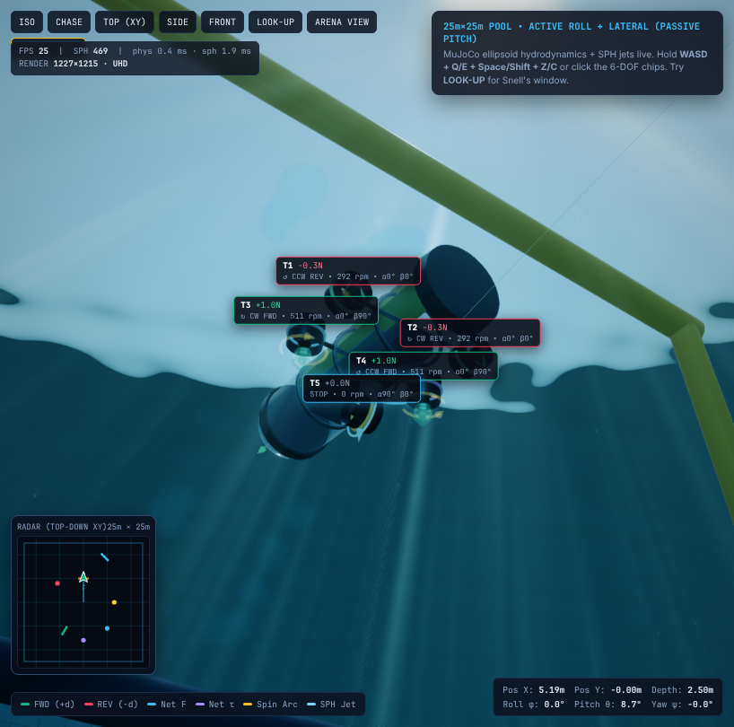
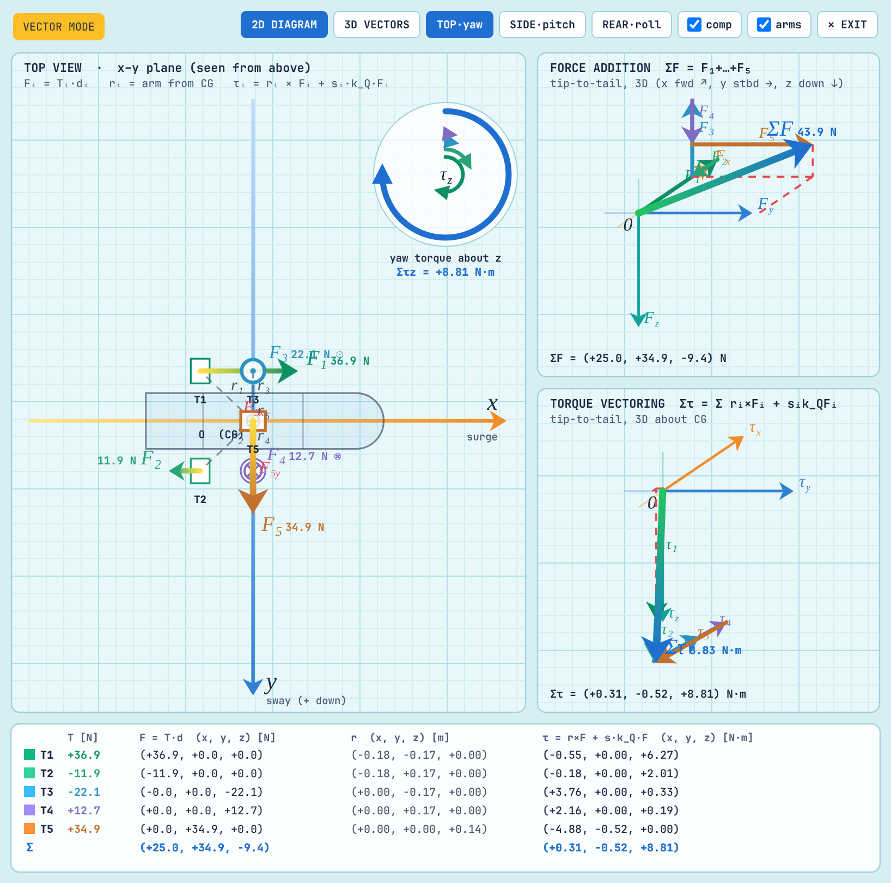

# AUV 5-Thruster Arena Simulator v4

A single-file browser simulator for the 5-thruster AUV. You can drive it in a 25 m test pool or in open ocean.

**Run it:** open [`auv_5thruster_arena_v4.html`](auv_5thruster_arena_v4.html) in Chrome, Edge or Firefox. It loads three.js r128 from a CDN, so it needs internet.



## Controls

| Key | Action |
|---|---|
| `W` / `S` | Surge forward / back |
| `A` / `D` | Sway left / right |
| `Q` / `E` | Yaw left / right |
| `Space` / `Shift` | Heave up / down |
| `Z` / `C` | Roll left / right |
| `V` | Vector Mode on / off |

The **↗ VECTOR MODE** button in the header does the same as `V`.

## What it models

- **Hydrodynamics.** Uses the [MuJoCo ellipsoid fluid model](https://mujoco.readthedocs.io/en/stable/computation/fluid.html). The hull and each thruster duct are separate shapes, and each one gets:
  - added mass, from Tuckerman κ integrals
  - blunt and slender drag, and angular drag
  - Kutta and Magnus lift
  - Stokes viscous drag
- **MuJoCo inertia-box model.** Available as a switch.
- **Rigid-body equations.** Rigid-body and added-mass Coriolis terms, including the Munk moment, solved with a MuJoCo-style implicit integrator.
- **Environment.**
  - Buoyancy drops as the hull breaks the water surface.
  - Currents, and ocean waves that push on the hull.
  - Propeller thrust falls off with forward speed (K_T(J)), and thrusters lose thrust when out of the water.
  - The vehicle collides with the pool floor and walls.
- **Water jets.** Each thruster's jet is a particle (SPH) simulation, ported from [Maetveis/SPHWaterPhysics](https://github.com/Maetveis/SPHWaterPhysics) to JavaScript (Müller 2003 kernels, counting-sort grid). The jet slows down as it mixes with the surrounding water. When a jet hits the hull it pushes back on it.
- **Rendering.**
  - Caustics that blur with depth, and Snell's window seen from below.
  - Water that absorbs red light more than blue (Beer–Lambert, per colour channel).
  - Soft sun shadows and environment reflections.
  - The jets are drawn as a fluid surface.
  - A UHD quality setting that renders up to a 4K pixel budget and lowers resolution automatically if the frame rate drops.
  - On a slow machine, add `?gfx=balanced` to the URL.
- **Vector Mode.**
  - **2D diagram:** top, side or rear view. Shows each thruster's force with dashed components, its moment arm, the force and torque sums added tip-to-tail, and a live table.
  - **3D vectors:** arrows attached to the moving AUV.
- **Stabilize Assist.** Depth hold, heading hold, roll/pitch levelling and a DVL brake. Turn it off to fly the raw physics.



## Findings

1. The MuJoCo docs' projected-area formula gives the area of the shadow-boundary cross-section. That is the true projected area divided by cos α.
   - When flow hits the hull at an angle, this overestimates drag. In one test case it gave 0.119 m² against a true 0.098 m².
   - The simulator uses the exact area by default. A toggle switches back to MuJoCo's formula.
2. In the passive-pitch presets, the hull's Munk moment overpowers W·BG above about 0.9 m/s, so the nose dips at speed.
   - A speed governor limits surge in those presets, and the HUD explains why.

## Tests

Engine source files are in [`src/`](src), and match what is embedded in the HTML.

```bash
cd auv_simulator/src
node test_hydro.js   # 26 checks
node test_sph.js     # 7 checks
```

`test_hydro.js` checks:
- the κ identities, sphere added mass, and Lamb's prolate-spheroid values
- the projected area against a brute-force calculation
- equilibrium, terminal speeds, and roll period (0.892 s measured, 0.891 s predicted)
- floating, resting on the floor, and drifting in a current

`test_sph.js` checks:
- the jet slowing as it mixes with surrounding water
- the jet spreading along the floor when it hits it
- the hull push-back from a jet (30 N jet → 30 N on the hull)

## Limitations

- Only tested in headless Chromium with software WebGL. It has not been run on a real GPU.
- The simulator has not been compared against real hardware data.
