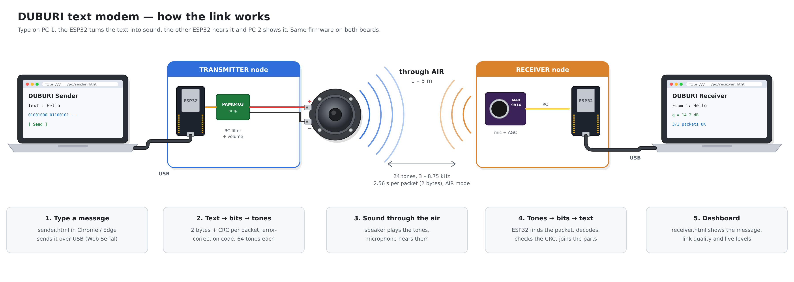
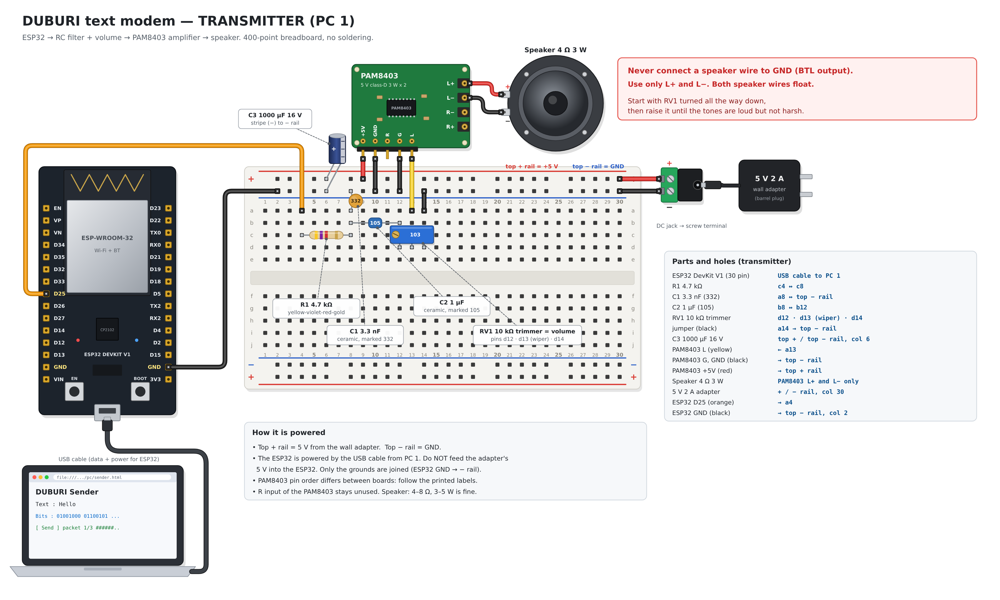
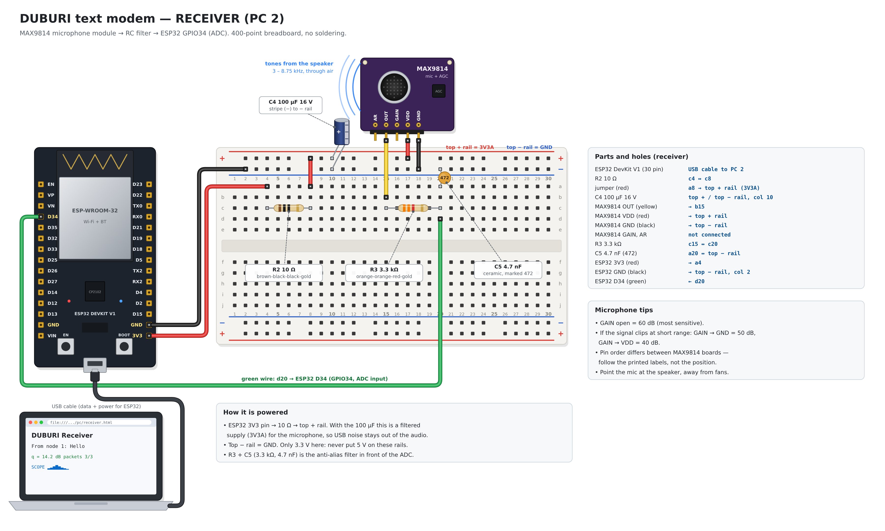
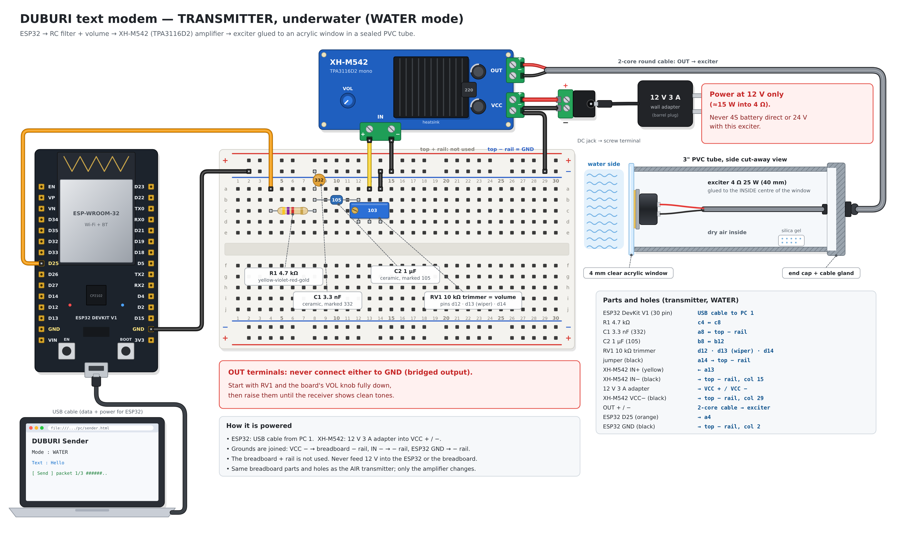
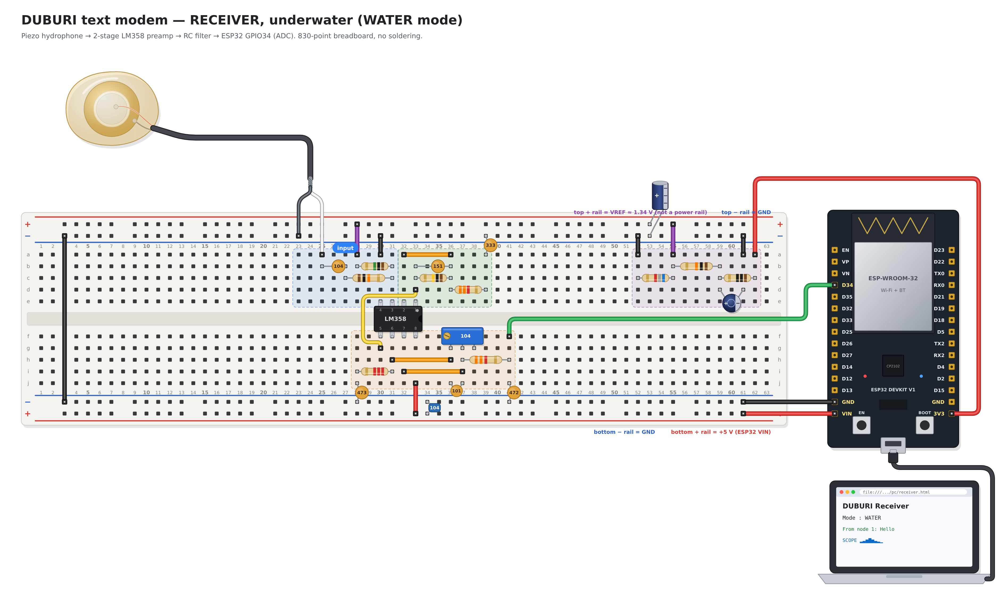
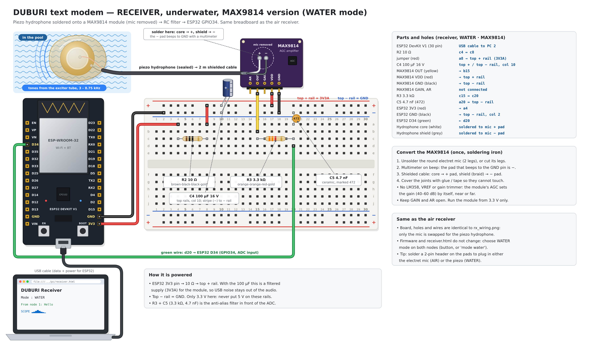

# DUBURI টেক্সট মডেম: PC → শব্দ → PC (AIR ও WATER মোড)

PC 1-এ একটা web page-এ লেখা টাইপ করো → ESP32 সেটাকে bit বানিয়ে speaker দিয়ে tone হিসেবে
বাজায় → অন্য ঘরের কোণে PC 2-এর ESP32 microphone দিয়ে শোনে, decode করে → PC 2-এর dashboard-এ
লেখাটা দেখায়। একই firmware দুই board-এ চলে, শুধু `config.h`-এ NODE_ID আলাদা।

| কী | কোথায় |
|---|---|
| Sender page | [`pc/sender.html`](../pc/sender.html) |
| Receiver dashboard | [`pc/receiver.html`](../pc/receiver.html) |
| Firmware | [`firmware/DuburiModem/`](../firmware/DuburiModem/) |
| Wiring ছবি ও hole-ধরে তালিকা | [`docs/wiring/`](wiring/) ([placement.md](wiring/placement.md)) |
| USB serial protocol | [`docs/SERIAL_PROTOCOL.md`](SERIAL_PROTOCOL.md) |

---

## 1. দুই মোড: AIR আর WATER

| | **AIR** (এখন যেটা বানাচ্ছ) | **WATER** (পুল, ROV) |
|---|---|---|
| Transmitter | PAM8403 + ছোট speaker, খোলা বাতাসে | XH-M542 amp + exciter, পানিরোধী tube-এর জানালায় লাগানো (অধ্যায় 9) |
| Receiver | MAX9814 microphone module | Piezo hydrophone + LM358 preamp, **বা** একই MAX9814 module (mic খুলে piezo লাগানো) (অধ্যায় 9) |
| এক slot | 40 ms (32 ms window) | 20 ms (16 ms window) |
| এক packet (2 byte লেখা) | 2.56 s | 1.28 s |
| দূরত্ব | ঘরে 1–5 m (simulation-এ যাচাই) | 10–25 m |
| Heat guard | গড়ে 75 % সময় বাজাতে পারে, একটানা 10 s পর্যন্ত | 50 %, একটানা 6 s |

**কেন আলাদা timing:** বাতাসে শব্দের গতি 343 m/s, পানিতে 1480 m/s। ঘরের দেয়াল-মেঝে শব্দ খুব ফিরিয়ে দেয়,
তাই ঘরে echo অনেকক্ষণ (0.4–1.3 s) থাকে। আগের tone-এর echo পরের tone-এর উপর পড়ে। Slot লম্বা করলে
প্রতিটা tone মাপার সময় বেশি হয়, আর একই frequency set আবার আসার আগে echo বেশি কমে যায়।
Simulation-এর ফল (প্রতিটা ঘরে 30টা packet, `sim/air_sim.py`):

| ঘর (RT60 = echo 60 dB কমতে যত সময়) | SNR | 20 ms slot | 30 ms | **40 ms** |
|---|---|---|---|---|
| আসবাবওয়ালা ঘর (0.44 s) | −4 dB | 17/30 | 26/30 | **30/30** |
| খালি, টাইলস-দেয়াল ঘর (0.80 s) | 0 dB | 25/30 | 29/30 | **30/30** |
| খালি, টাইলস-দেয়াল ঘর (0.80 s) | −4 dB | 4/30 | 18/30 | **26/30** |
| হলঘর (1.26 s) | −4 dB | 8/30 | 20/30 | **27/30** |

SNR 6 dB-এ (সাধারণ শান্ত ঘর) তিনটাই ~100 %। শব্দ বেশি বা ঘর ফাঁকা হলে 40 ms অনেক ভালো, তাই AIR = 40 ms।
একটানা কয়েকটা packet (একটা লম্বা message) পাঠিয়েও দেখা হয়েছে: ঘরে 60/60 packet ঠিক,
পুলে (WATER, −4 dB) ~95 %।

**দুই board-কে একই মোডে রাখতে হবে।** না হলে receiver কিছুই পাবে না (এটা test-এ যাচাই করা)। মোড বদলানোর
তিন উপায়: web page-এর AIR/WATER বোতাম, Serial Monitor-এ `mode air` / `mode water`, বা `config.h`-এর
`DEFAULT_MODE`। বোতাম/কমান্ড দিয়ে বদলালে সেটা board-এর flash-এ থেকে যায় (বন্ধ করলেও)।

---

## 2. কী কী কিনতে হবে (AIR, দুই board)

দাম বাংলাদেশের অনলাইন দোকানের মোটামুটি দাম (নভেম্বর 2026-এ দেখা), দোকানভেদে কমবেশি হবে।

### Transmitter board (PC 1)

| জিনিস | সংখ্যা | আনুমানিক দাম (৳) | মন্তব্য |
|---|---|---|---|
| ESP32 DevKit V1 (WROOM-32, 30 pin) | 1 | 450–650 | "DOIT ESP32 DevKit V1" |
| PAM8403 amplifier module | 1 | 30–120 | volume knob থাকলেও চলবে |
| Speaker 4 Ω বা 8 Ω, 3 W, 40–57 mm | 1 | 130–250 | তোমার নিজের speaker-ও চলবে (4–8 Ω) |
| Resistor 4.7 kΩ | 1 | ~2 | রং: হলুদ-বেগুনি-লাল-সোনালি |
| Trimmer pot 10 kΩ (নীল) | 1 | 10–20 | volume (RV1) |
| Ceramic capacitor 3.3 nF (গায়ে লেখা **332**) | 1 | ~3 | C1 |
| Ceramic capacitor 1 µF (গায়ে লেখা **105**) | 1 | ~5 | C2, DC আটকায় |
| Electrolytic capacitor 1000 µF 16 V | 1 | 15–30 | amp-এর supply-তে |
| 5 V 2 A adapter + DC jack screw-terminal adapter | 1+1 | 150–250 + 30–50 | amp-এর আলাদা power |
| Breadboard 400 point | 1 | 80–120 | |
| Jumper wire (male-male আর male-female) | 1 সেট | 100–150 | |
| Micro-USB **data** cable | 1 | 80–150 | শুধু-চার্জ cable-এ কাজ হবে না |

### Receiver board (PC 2)

| জিনিস | সংখ্যা | আনুমানিক দাম (৳) | মন্তব্য |
|---|---|---|---|
| ESP32 DevKit V1 (WROOM-32, 30 pin) | 1 | 450–650 | |
| MAX9814 microphone AGC amplifier module | 1 | 360–500 | auto gain, 3.3 V-এ চলে |
| Resistor 10 Ω | 1 | ~2 | রং: বাদামি-কালো-কালো-সোনালি |
| Resistor 3.3 kΩ | 1 | ~2 | রং: কমলা-কমলা-লাল-সোনালি |
| Ceramic capacitor 4.7 nF (গায়ে লেখা **472**) | 1 | ~3 | anti-alias filter |
| Electrolytic capacitor 100 µF 16 V | 1 | ~10 | mic-এর পরিষ্কার supply |
| Breadboard 400 point, jumper wire, USB data cable | — | 260–420 | |

**মোট খরচ: প্রায় ৳2,200–3,400** (দুই board মিলিয়ে, PC বাদে)।
কেন MAX9814: এতে AGC (auto gain) আছে, কাছে-দূরে দুই অবস্থাতেই signal clip না করে ঠিক মাপে থাকে। এর output
1.25 V-এর উপর বসানো আর সর্বোচ্চ 2 V p-p, যা ESP32 ADC-র সবচেয়ে ভালো অংশে (0.15–2.45 V) পড়ে। KY-037/KY-038
"sound sensor" কিনো না: ওগুলো শুধু শব্দ আছে/নেই বলে, ঠিক audio দেয় না।

---

## 3. Transmitter-এর wiring (PC 1)

Signal-এর পথ: ESP32 **D25** → R1 4.7 kΩ → (C1 3.3 nF নিচে GND-এ) → C2 1 µF → RV1 trimmer-এর উপরের মাথা →
RV1-এর মাঝের পা (wiper) → PAM8403 **L** input → **L+ / L−** → speaker।

Breadboard-এ (প্রতিটা column-এর a–e পাঁচটা ছিদ্র ভেতরে জোড়া; উপরের লাল লাইন = +5 V, নীল লাইন = GND):

| ধাপ | কী লাগাবে | কোথায় |
|---|---|---|
| 1 | ESP32 GND (ডান সারির নিচ থেকে 2য় পিন) → নীল (GND) rail | GND → নীল rail, col 2 |
| 2 | ESP32 **D25** → breadboard (কমলা তার) | D25 → a4 |
| 3 | R1 4.7 kΩ | c4 – c8 |
| 4 | C1 3.3 nF (332) | a8 – নীল rail (col 8) |
| 5 | C2 1 µF (105) | b8 – b12 |
| 6 | RV1 10 kΩ trimmer (তিন পা, গায়ে 103) | d12, d13 (মাঝের পা), d14 |
| 7 | RV1-এর শেষ পা GND-এ (কালো jumper) | a14 – নীল rail (col 14) |
| 8 | C3 1000 µF | **+** পা লাল rail (col 6), **−** পা (সাদা দাগের দিক) নীল rail (col 6) |
| 9 | PAM8403 power | **+5V** → লাল rail (col 9); **GND** → নীল rail (col 10) |
| 10 | PAM8403 input | **L** ← a13 (হলুদ তার); input **G** → নীল rail (col 12); **R** খালি |
| 11 | 5 V adapter | DC jack screw-terminal **+** → লাল rail (col 30), **−** → নীল rail (col 30) |
| 12 | Speaker | PAM8403 **L+** আর **L−**-এ শুধু |

> ⚠ **Speaker-এর কোনো তার কখনো GND-এ লাগাবে না।** PAM8403-এর output-এর দুই পাশেই signal থাকে (BTL)।
> GND-এ লাগালে amp short হয়ে গরম হবে বা পুড়বে।
> ⚠ **শুরুতে RV1 একদম কমিয়ে রাখো**, পরে আস্তে আস্তে বাড়াও। শব্দ কর্কশ হলে amp clip করছে, একটু কমাও।
> ⚠ C3 1000 µF-এর দিক ভুল করবে না (− দাগ = GND)। Adapter-এর 5 V কখনো ESP32-এ দেবে না; ESP32 চলে USB থেকে,
> শুধু দুই দিকের GND এক (নীল rail)।

Amp-এর জন্য আলাদা 5 V adapter কেন: amp বাজানোর সময় হঠাৎ অনেক current টানে। PC-র USB থেকে চালালে ESP32
reset হতে পারে আর USB port-এ চাপ পড়ে। খুব কম volume-এ শুধু পরীক্ষার জন্য ESP32-এর VIN পিন থেকে চালানো যায়,
কিন্তু সেটা স্থায়ী ব্যবস্থা না। দুই supply-র GND একসাথে (নীল rail) থাকতেই হবে।

PAM8403 module-ভেদে পিনের নাম একটু আলাদা হয় (যেমন `L ⏚ R`, `VCC GND`, `L+ L− R− R+`)। **board-এর গায়ে
লেখা নাম দেখে** লাগাও। পিনে header না থাকলে তার solder করতে হবে।

---

## 4. Receiver-এর wiring (PC 2)

Signal-এর পথ: MAX9814 **OUT** → R3 3.3 kΩ → ESP32 **D34** (GPIO34), আর সেখান থেকে C5 4.7 nF → GND।
R3 + C5 একটা low-pass filter (≈10 kHz): ADC 50 kHz-এ sample করে, তাই 25 kHz-এর উপরের শব্দ/noise
কেটে দিতে হয়, না হলে সেটা ভুল frequency হয়ে আমাদের tone-এর মধ্যে ঢুকে পড়ে (aliasing)।
Mic-এর supply ESP32-এর 3V3 থেকে R2 10 Ω + C4 100 µF দিয়ে পরিষ্কার করা (ESP32-এর 3V3-এ digital noise থাকে)।

| ধাপ | কী লাগাবে | কোথায় |
|---|---|---|
| 1 | ESP32 GND (ডান সারির নিচ থেকে 2য় পিন) → নীল (GND) rail | GND → নীল rail, col 2 |
| 2 | ESP32 **3V3** (ডান সারির একদম নিচের পিন) → breadboard | 3V3 → a4 |
| 3 | R2 10 Ω | c4 – c8 |
| 4 | পরিষ্কার 3.3 V → লাল rail (লাল jumper) | a8 – লাল rail (col 8) |
| 5 | C4 100 µF | **+** লাল rail (col 10), **−** নীল rail (col 10) |
| 6 | MAX9814 power | **VDD** → লাল rail (col 17); **GND** → নীল rail (col 18) |
| 7 | MAX9814 OUT (হলুদ তার) | OUT → b15 |
| 8 | R3 3.3 kΩ | c15 – c20 |
| 9 | C5 4.7 nF (472) | a20 – নীল rail (col 20) |
| 10 | ESP32-এ signal (সবুজ তার) | d20 → ESP32 **D34** (বাম সারির উপর থেকে 4র্থ পিন) |

MAX9814-এর **GAIN** আর **AR** পিন খোলা রাখো (gain 60 dB)। Mic speaker-এর খুব কাছে (< 1 m) হলে আর
receiver page-এ "clipping" দেখালে GAIN পিন GND-এ (50 dB) বা VDD-তে (40 dB) লাগাও। এখানে লাল rail-এ 3.3 V, 5 V না।
**MAX9814-এ কখনো 5 V দেবে না যদি OUT সরাসরি ESP32-এ যায়** (তখন output 3.3 V ছাড়াতে পারে)।

---

## 5. Firmware upload

1. Arduino IDE 2.x → Boards Manager URL: `https://espressif.github.io/arduino-esp32/package_esp32_index.json` →
   "esp32 by Espressif Systems" **3.x**।
2. `firmware/DuburiModem/DuburiModem.ino` খোলো। Board: "ESP32 Dev Module"।
3. `config.h`: transmitter board-এ `NODE_ID 1`, `PEER_ID 2`; receiver board-এ `NODE_ID 2`, `PEER_ID 1`।
   `DEFAULT_MODE AM_MODE_AIR` থাকবে।
4. Upload। Windows-এ port না দেখালে board-এর USB chip-এর driver দাও (CP2102 বা CH340)।
5. Serial Monitor (115200, "Newline") খুলে দেখো: `INFO node=1 ... mode=air ...`। তারপর **Serial Monitor বন্ধ করো**,
   না হলে web page port খুলতে পারবে না।

---

## 6. Web page চালানো

* **Google Chrome বা Microsoft Edge** (computer-এ) লাগবে। Firefox/Safari-তে Web Serial নেই।
* File দুটো যেকোনো folder-এ রেখে double-click করে খোলো, internet লাগে না।
* PC 1: `pc/sender.html` → **Connect** → তালিকা থেকে ESP32-এর port (CP210x / CH340 / USB Serial) বেছে নাও।
  উপরে node, peer আর মোড (AIR/WATER) দেখাবে।
* PC 2: `pc/receiver.html` → **Connect**।
* Sender-এ লেখা টাইপ করলে সাথে সাথে দেখাবে: অক্ষর → UTF-8 byte → bit → packet (header, data, CRC-16) → কত
  সেকেন্ড লাগবে। **Send** চাপলে প্রতিটা packet-এর 64টা tone piano-roll-এ বাজতে দেখা যাবে।
* Receiver-এ packet আসা শুরু হলেই "packet arriving" দেখাবে, প্রতিটা packet-এর লেখা সাথে সাথে বসবে, শেষে পুরো
  message, link quality (q, dB) graph, counter আর mic level দেখাবে।
* Board ছাড়াই কেমন দেখায় দেখতে চাইলে দুই page-এই **Demo** switch আছে (নকল board, কোনো শব্দ হয় না)।
  সত্যিকারের শব্দ দিয়ে, কিন্তু board ছাড়া পরীক্ষা করতে নিচের 6.1 দেখো।
* বাংলাও পাঠানো যায়। প্রতিটা বাংলা অক্ষর UTF-8-এ 3 byte, তাই এক message-এ সর্বোচ্চ 64 byte ≈ 21টা বাংলা অক্ষর
  বা 64টা ইংরেজি অক্ষর।

### 6.1 বোর্ড ছাড়া, শুধু ল্যাপটপের speaker আর mic দিয়ে

কোনো ESP32 না কিনেই code কাজ করে কি না দেখা যায়। Page দুটো নিজেরাই modem চালায় (`pc/amcore.js`, firmware-এর
C code-এর হুবহু JavaScript রূপ, একই recording-এ C আর JavaScript একই ফল দেয়)।

**এক ল্যাপটপে:**
1. Chrome/Edge-এ `pc/receiver.html` আর `pc/sender.html` **দুটো আলাদা window-এ** পাশাপাশি খোলো (tab না,
   পেছনের tab-কে browser ধীর করে দেয়)।
2. Receiver-এ **Use this computer's microphone** → browser জিজ্ঞেস করলে **Allow**।
3. Sender-এ **Use this computer's speaker**। দুই page-এ মোড **AIR** দেখাবে।
4. ল্যাপটপের volume 50–70 %। Headphone/Bluetooth speaker খুলে রাখো (শব্দ যেন ল্যাপটপের নিজের speaker থেকে বের হয়)।
5. Receiver-এ **Show live tone bars**, sender-এ **Tone test (5 kHz)**: 5k-এর কাছের বার লাফাবে।
6. Sender-এ `Hi` লিখে **Send**। ~3 সেকেন্ড পর receiver-এ "Hi" আসবে।

**দুই ল্যাপটপে:** একটায় sender.html (speaker), অন্যটায় receiver.html (microphone), 1–3 m দূরে, একই ধাপ।
একটা ল্যাপটপ আর একটা ESP32 board-ও একে অপরের সাথে কথা বলতে পারে (একই মোডে)।

বার না লাফালে: Chrome-এর ঠিকানা-বারের mic আইকন থেকে ঠিক microphone বেছে নাও; Windows-এ Sound settings →
Microphone → "Audio enhancements" বন্ধ করো (কিছু ল্যাপটপ নিজে থেকে noise কাটে, তাতে আমাদের tone-ও কেটে যায়)।

---

## 7. প্রথম পরীক্ষা, ধাপে ধাপে (AIR)

1. দুই board, দুই PC চালু। দুই page-এ মোড **AIR** দেখাচ্ছে কি না দেখো।
2. Speaker আর mic 1 m দূরে, মুখোমুখি। RV1 একদম কম।
3. Receiver page-এ **Scope on**। ঘর চুপ থাকলে সব বার প্রায় 0 dB-এর কাছে থাকবে।
4. Sender page-এর **Tone test** (5000 Hz)। Receiver-এ 5000 Hz-এর বার উঠবে। RV1 বাড়াও যতক্ষণ বারটা 15–25 dB হয়।
   Receiver-এর level meter "OK" দেখাবে ("clipping" দেখালে volume কমাও বা GAIN পিন GND/VDD-তে দাও)।
5. **Sweep** চাপো: 24টা tone একে একে বাজবে, receiver-এ বারগুলো একে একে উঠবে। কোনোটা খুব নিচু হলে speaker সেই
   frequency-তে দুর্বল, সমস্যা নেই, error correction সামলায়।
6. এবার `Hi` পাঠাও (1 packet, ~2.6 s)। Receiver-এ "Hi" আসবে, q ≥ 10 dB হলে নিশ্চিন্ত।
7. দূরত্ব বাড়াও 3 m, 5 m। q 7 dB-এর নিচে নামলে volume বাড়াও বা কাছে আনো।

---

## 8. কত দ্রুত (সৎভাবে)

এটা শব্দ দিয়ে পাঠানো, তাই ধীর। নির্ভরযোগ্যতার জন্য প্রতি 2 byte-এ একটা পুরো packet (error correction + CRC):

| | AIR | WATER |
|---|---|---|
| এক packet (2 byte) | 2.56 s + 0.4 s ফাঁক | 1.28 s + 0.4 s ফাঁক |
| "Hi" (2 byte) | ~2.6 s | ~1.3 s |
| "Hello DUBURI" (12 byte) | ~18 s | ~10 s |
| 64 byte (সর্বোচ্চ) | ~1.8 মিনিট | ~1.3 মিনিট |

লম্বা message-এ মাঝে মাঝে `HEAT-GUARD wait` দেখাবে: speaker ঠান্ডা হওয়ার বিরতি। খুব শব্দময় জায়গায় sender
page-এ **Repeat 2×** দাও: প্রতিটা packet দুবার যাবে, receiver দ্বিতীয়টা ফেলে দেবে (একটা হারালেও অন্যটা আসে)।

---

## 9. WATER (পানির নিচে) build: exciter tube + piezo hydrophone

Firmware-এ WATER মোড তৈরি আছে (20 ms slot, পুল simulation-এ যাচাই করা)। পানির নিচে দুটো জিনিস বদলায়:
**speaker-এর জায়গায় exciter tube**, আর **MAX9814 mic-এর জায়গায় piezo hydrophone + preamp**
(MAX9814-এর mic পানিতে কাজ করে না: বাতাসের mic, পানি থেকে শব্দ প্রায় ঢোকে না)। Web page, protocol, firmware একই,
শুধু দুই board-এ মোড **WATER**।

| | ছবি |
|---|---|
| Transmitter (exciter tube + XH-M542, 12 V) |  |
| Receiver (piezo hydrophone + LM358 preamp) |  |
| Receiver, সহজ version (piezo hydrophone + MAX9814, mic খোলা; অধ্যায় 9.5) |  |

Breadboard-এর প্রতিটা ছিদ্রের তালিকা: [`wiring/placement.md`](wiring/placement.md) (script দিয়ে সব সংযোগ যাচাই করা)।

### 9.1 কেনাকাটা (দেশি দোকান, আনুমানিক দাম)

**Transmitter**

| জিনিস | দাম (৳) | কোথায় / মন্তব্য |
|---|---|---|
| ESP32 DevKit V1 | 450–650 | আগের মতো |
| XH-M542 amplifier (TPA3116D2, mono) | ~680 | ElectronicsBD |
| Exciter 40 mm, **4 Ω**, 25 W ("resonance sound exciter") | ~677 + shipping ~722 | AliExpress |
| 12 V 3 A adapter + DC jack screw-terminal | 300–450 | Amp শুধু **12 V**-এ (4 Ω-এ ≈15 W)। 4S battery সরাসরি বা 24 V কখনো না। ROV-এ 3S battery সরাসরি চলবে |
| 4.7 kΩ, 3.3 nF (332), 1 µF (105), 10 kΩ trimmer, breadboard, jumper | ~250 | আগের TX-এর মতো |
| PVC pipe 3" ~15 cm + end cap (প্যাঁচওয়ালা হলে ভালো) | 200–400 | Tube |
| Acrylic/polycarbonate disc 4 mm (pipe-এর বাইরের মাপে) | 100–200 | জানালা |
| 2-part epoxy (Araldite), cable gland PG7/PG9, 2-core **গোল** cable, silica gel | 300–500 | Food box-এর PP/PE plastic-এ epoxy লাগে না, ব্যবহার কোরো না |

**Receiver**

| জিনিস | দাম (৳) | কোথায় / মন্তব্য |
|---|---|---|
| ESP32 DevKit V1 | 450–650 | |
| **Piezo:** guitar contact pickup (cable লাগানো) **বা** 35 mm piezo disc + 2 m shielded mic cable | 360–380 **বা** 60–140 + 60–120 | Othoba / Daraz / ElectronicsBD। 2–3টা কেনো |
| Liquid electrical tape বা 2-part epoxy | 150–300 | Piezo সিল করতে |
| **LM358** op-amp (DIP-8) | 10–15 | যেকোনো electronics দোকান (MCP602/MCP6002 পেলে আরো ভালো) |
| Resistor: 10 Ω, 10 kΩ ×2, 6.8 kΩ, 1 MΩ, 100 kΩ, 3.3 kΩ ×2, 2.2 kΩ; trimmer 100 kΩ | ~60 | |
| Capacitor: 100 nF ×2, 150 pF, 33 nF, 100 pF, 47 nF, 4.7 nF, 100 µF, 10 µF | ~80 | |
| Breadboard 830 point, jumper | 150–250 | |

মোট মোটামুটি: **Transmitter ≈ ৳3,000–4,000**, **Receiver ≈ ৳1,300–1,800**।

**LM358 না চাইলে (অধ্যায় 9.5):** LM358, উপরের resistor/capacitor-এর তালিকা আর 830-point board লাগবে না। লাগবে
শুধু air receiver-এর জিনিসগুলো: **MAX9814 module** (৳360–500), 10 Ω, 3.3 kΩ, 100 µF, 4.7 nF (472), 400-point breadboard।
Piezo আর সিল করার জিনিস একই।

### 9.2 Exciter tube বানানো (transmitter)

Exciter নিজে waterproof করা যায় না (epoxy লাগালে তার নড়াচড়ার অংশ আটকে যায়)। তাই exciter থাকে **শুকনো tube-এর ভেতরে**,
একটা পাতলা জানালার ভেতরের দিকে আঠা দিয়ে লাগানো; শুধু জানালা পানি ছোঁয়, জানালাটাই speaker হয়ে যায়।

1. **জানালা:** pipe-এর মুখ আর disc-এর কিনারা শিরিষ কাগজে (120) ঘষো, alcohol দিয়ে মোছো, epoxy দিয়ে disc লাগাও।
   ভেতরে-বাইরে জোড়ার চারপাশে আরেক প্রলেপ। **24 ঘণ্টা** শুকাতে দাও।
2. **Exciter:** জানালার ভেতরের মাঝখানে হালকা ঘষে, পাতলা সমান epoxy দিয়ে exciter-এর সমতল পা লাগাও (বাতাসের বুদবুদ নয়,
   পা আর শরীরের মাঝের ফাঁকে epoxy নয়)। ওপরে ভার দিয়ে **24 ঘণ্টা**। শক্ত বন্ধন = বেশি শব্দ পানিতে যায়।
3. **Cable:** end cap-এ ছিদ্র করে cable gland, গোল cable ঢুকিয়ে টাইট করো, বাইরে চারপাশে epoxy।
4. **তার:** exciter-এ solder, heat-shrink, তার বেঁধে রাখো যাতে জানালায় ঠকঠক না করে। Silica gel দিয়ে end cap বন্ধ করো।
5. **Leak test:** ভেতরে শুকনো টিস্যু রেখে বালতিতে 30 মিনিট, তারপর পুলের তলায় (2–5 m) 1 ঘণ্টা। টিস্যু শুকনো থাকলে ঠিক।
6. Tube ভাসে (~1 kg উঠানোর জোর), তাই ভার বাঁধো বা ROV frame-এ শক্ত করে লাগাও, জানালা খোলা পানির দিকে।
   XH-M542 থাকে ROV-এর শুকনো electronics box-এ, tube-এ শুধু cable যায়।

জানালার শক্তি (মূল গাইড অধ্যায় 8-এর সূত্রে): 3" pipe-এ 4 mm acrylic, 5 m গভীরে stress ≈ 4 MPa, acrylic সহ্য করে ≈ 70 MPa।

Wiring: RV1-এর মাঝের পা → XH-M542 **IN +**, GND → **IN −**, 12 V → **VCC + / −**, VCC − থেকে breadboard GND-এ একটা তার,
**OUT** দুই screw → exciter। প্রথমবার: exciter আগে, তারপর input, power সবশেষে; RV1 আর board-এর VOL একদম কম।

### 9.3 Piezo hydrophone বানানো (receiver)

* **Guitar pickup হলে:** cable আর piezo আগেই লাগানো। পুরো pickup আর cable বের হওয়ার জায়গা liquid electrical tape-এ
  3–4 বার চুবাও (প্রতিবার শুকিয়ে), বা বোতলের ছিপিতে বসিয়ে epoxy ঢালো। শব্দ-ধরার দিকে পাতলা প্রলেপ, **কোনো বাতাস নয়**।
  Plug কেটে cable-এর ভেতরের তার আর shield breadboard-এ নাও।
* **Piezo disc হলে:** shielded cable-এর ভেতরের তার ceramic (রুপালি) অংশে, shield পিতলের কিনারায়, 2–3 সেকেন্ডে solder
  (বেশি গরমে রুপালি স্তর ওঠে)। Alcohol দিয়ে পরিষ্কার, cable-এ গিঁট/heat-shrink দিয়ে টান সামলাও, তারপর উপরের মতো সিল।
* 24 ঘণ্টা শুকাও। একদিন পানিতে রেখে multimeter-এ দুই তারের মাঝে resistance অসীম থাকলে leak নেই।
* বিস্তারিত ছবি: মূল গাইড অধ্যায় 9।

### 9.4 Preamp (LM358)

Piezo-র signal কয়েক mV, ESP32-এর ADC-তে কয়েকশো mV লাগে। দুই stage-এর amplifier (মূল গাইড অধ্যায় 10, op-amp শুধু LM358):

| | মান |
|---|---|
| Stage 1 gain | 1 + 100k/3.3k = 31 (30 dB) |
| Stage 2 gain (RV2) | 1 … 46 (0 … 33 dB) |
| মোট | 30 … 63 dB |
| কোন frequency যায় | ≈1.5 kHz থেকে ≈10 kHz (আমাদের 3–8.75 kHz পুরো gain পায়; pump hum আর pinger কাটে) |
| VREF | 3.3 × 6.8k / (10k + 6.8k) ≈ 1.34 V (signal এর চারপাশে দোলে) |
| Power | LM358 ESP32-এর **VIN** (USB-র ≈5 V) থেকে; VREF আর filter 3V3 থেকে। Ro 3.3 kΩ ESP32-এর pin রক্ষা করে |

**RV2 = receiver-এর volume।** Tone bar নিচু থাকলে বাড়াও, level meter "clipping" দেখালে কমাও।

### 9.5 সহজ বিকল্প: LM358-এর বদলে MAX9814 module

MAX9814 module-এর উপরে একটা গোল **built-in mic (electret)** থাকে। ওটা খুলে ফেলে তার দুই pad-এ piezo-র তার solder করলে
module-টাই piezo-র amplifier হয়ে যায়। তখন LM358, VREF, RV2 আর প্রায় সব resistor/capacitor বাদ। Breadboard, ছিদ্র আর তার
**হুবহু air receiver-এর মতো** (অধ্যায় 4); শুধু mic-এর জায়গায় piezo। ছবি: `wiring/rx_water_max9814_wiring.png`।

1. Module-এর গোল mic-টা soldering iron দিয়ে খোলো (2টা পা), বা পা কেটে ফেলো।
2. Multimeter beep mode-এ: যে pad module-এর **GND** pin-এর সাথে beep দেয় সেটা **−**, অন্যটা **+**।
3. Hydrophone-এর shielded cable: ভেতরের তার → **+** pad, shield (জাল) → **−** pad। জোড়াগুলো আঠা/tape দিয়ে ঢেকে দাও।
4. বাকিটা air receiver: VDD → 3V3A (top + rail), GND → GND, OUT → b15 (3.3 kΩ → GPIO34, 4.7 nF → GND)।
   **GAIN আর AR খোলা।** Module-এ শুধু **3.3 V**, কখনো 5 V না।
5. **Firmware বা web page-এ কিছু বদলাতে হবে না।** ESP32 GPIO34-এ শব্দ ঢুকলেই হলো; firmware নিজেই DC বাদ দেয়
   (MAX9814-এর ≈1.25 V বা LM358-এর 1.34 V, দুটোই চলে)। দুই board-এ শুধু মোড **WATER**।

Gain হাতে ঠিক করতে হয় না: module-এর AGC নিজেই 40–60 dB-এর মধ্যে রাখে (কাছে জোরালো signal হলে কমায়)।
Tip: pad-এ একটা 2-pin header লাগালে এক module-এ electret mic (AIR) আর piezo (WATER) দুটোই plug করা যায়।

**Simulation (25 × 25 × 8 m pool, `sim/frontend_sim.py`):** 1 থেকে 32 m, তিন noise অবস্থায় (pump বন্ধ, pump চালু,
নিজের thruster চালু) LM358 আর MAX9814 দুটোই 20/20। Signal ইচ্ছা করে দুর্বল করলে thruster চালু অবস্থায় দুটো একই জায়গায়
fail করে (তখন পানির noise-ই সীমা); একদম শান্ত পুলে MAX9814 সামান্য ভালো (নিজের noise কম)। এটা simulation, আসল
পুলে 9.6-এর ধাপে যাচাই করো।

### 9.6 পরীক্ষা, ধাপে ধাপে

1. দুই board-এ মোড **WATER** (web page-এর বোতাম, বা `mode water`)।
2. **শুকনো:** receiver page-এ Scope on; hydrophone-এ আঙুল দিয়ে আলতো টোকা দিলে level লাফাবে।
3. **বালতি/ড্রাম:** tube আর hydrophone 0.5–1 m দূরে পানিতে। RV1, VOL কম। **Tone test** → 5 kHz-এর বার উঠবে।
   Bar 15–25 dB হওয়া পর্যন্ত RV1/VOL বাড়াও; level "OK" রাখতে RV2 ঠিক করো (MAX9814 version-এ RV2 নেই, AGC নিজেই করে)। **Sweep** → 24টা বার একে একে।
4. `Hi` পাঠাও (1.28 s)। আসবে, q দেখো।
5. **পুল:** 5, 10, 20 m-এ q লিখে রাখো। আনুমানিক range ≈ দূরত্ব × 2^((q − 8) ÷ 6)।
6. Thruster চালিয়ে আবার দেখো। q অনেক নামলে hydrophone thruster আর amp-এর তার থেকে দূরে, নরম রাবারে লাগাও।
7. লম্বা message-এর পর exciter-এর গরম মাপো (মূল গাইড 7.6-এর resistance পদ্ধতি)। WATER-এ heat guard 50 %।

---

## 10. সমস্যা হলে

| লক্ষণ | কারণ / সমাধান |
|---|---|
| Page-এ "Web Serial not available" | Chrome/Edge ব্যবহার করো |
| Connect-এ port নেই | data cable? driver (CP2102/CH340)? Serial Monitor বন্ধ? |
| Receiver-এ কিছুই আসে না | দুই board একই মোডে? `DET` আসছে কি না দেখো। না এলে volume/দূরত্ব/scope দেখো |
| `DET` আসে কিন্তু `CRCFAIL` | signal দুর্বল বা echo বেশি: কাছে আনো, volume বাড়াও, Repeat 2× |
| Level meter "clipping" | volume কমাও, বা MAX9814 GAIN → GND (50 dB) / VDD (40 dB) |
| Level meter "too quiet" / rms খুব কম | MAX9814-এর VDD/GND/OUT তার দেখো |
| Sender board reset হয় | amp-কে আলাদা 5 V adapter থেকে দাও, GND একসাথে |
| Speaker গরম | volume কমাও; `config.h`-এ AIR_TX_DUTY কমাও |
| `on`/`off`/`ping` "no reply" | এগুলো ACK চায়, তাই দুই board-এ speaker আর mic দুটোই লাগে। এক-দিকের link-এ text message ব্যবহার করো |
