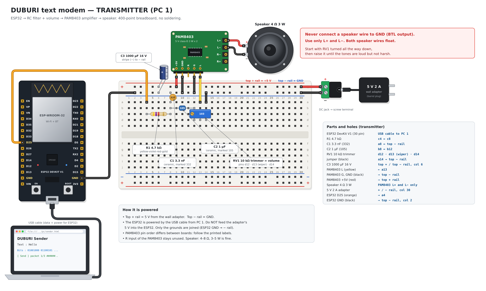
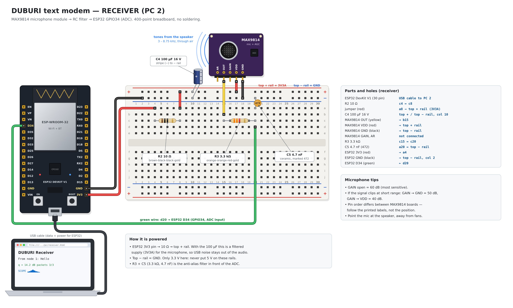
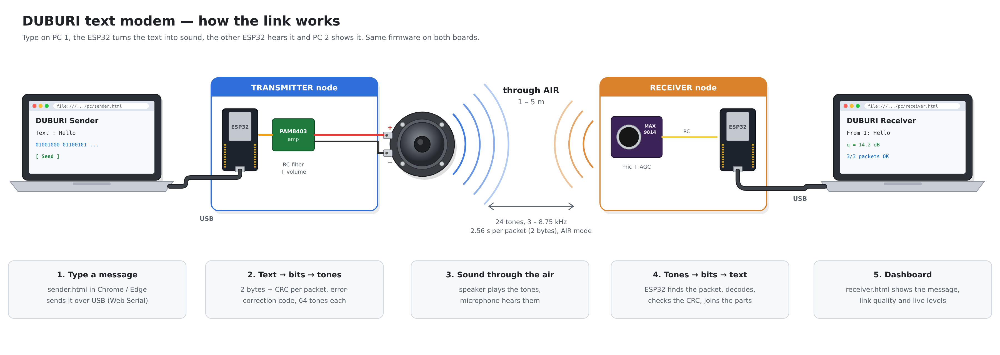

# Breadboard placement: DUBURI air-acoustic text modem

Generated by `wiring.py` (the script also checks every connection against the
circuit). Board: 400-point half breadboard. Columns 1–30 from left to right. Rows
`a`–`e` are the top half (`a` next to the top rails), `f`–`j` the bottom half. Each
column of `a`–`e` is one connected strip. Top rails: `TR1` = outer row with the red
line (+), `TR2` = inner row with the blue line (−). On these small boards the rail
has no hole at columns 1, 7, 13, 19 and 25.

ESP32 DevKit V1 (DOIT, 30 pins) and the modules sit next to the breadboard and are
joined with jumper wires (male-to-female for module pins and ESP32 pins).

## Transmitter node (PC 1)

Top + rail = 5 V from the wall adapter, top − rail = GND. The ESP32 is powered by
its USB cable; only its GND is joined to the − rail.

| Part | Value / marking | Holes |
|---|---|---|
| R1 | 4.7 kΩ (yellow-violet-red-gold) | `c4` ↔ `c8` |
| C1 | 3.3 nF ceramic, marked `332` | `a8` ↔ top − rail col 8 (`TR2-8`) |
| C2 | 1 µF ceramic, marked `105` | `b8` ↔ `b12` |
| RV1 | 10 kΩ trimmer, marked `103` | `d12` (end) · `d13` (wiper) · `d14` (end) |
| C3 | 1000 µF 16 V electrolytic | + leg top + rail col 6 (`TR1-6`), − leg (stripe) top − rail col 6 (`TR2-6`) |
| PAM8403 module | 5 V class-D amp | off the board, wired (see wires) |
| Speaker | 4 Ω, 3 W (4–8 Ω, 3–5 W OK) | PAM8403 `L+` and `L−` only |
| 5 V 2 A adapter + DC-jack-to-screw-terminal | | `+` → `TR1-30`, `−` → `TR2-30` |

### Wires

| From | To | Colour | What it is |
|---|---|---|---|
| ESP32 D25 | `a4` | orange | tone signal |
| ESP32 GND (right side, 2nd from bottom) | top − rail col 2 (`TR2-2`) | black | common ground |
| `a14` | top − rail col 14 (`TR2-14`) | black | RV1 low end to ground |
| PAM8403 L | `a13` | yellow | volume wiper to amp input |
| PAM8403 G | top − rail col 12 (`TR2-12`) | black | amp input ground |
| PAM8403 +5V | top + rail col 9 (`TR1-9`) | red | amp power +5 V |
| PAM8403 GND | top − rail col 10 (`TR2-10`) | black | amp power ground |
| DC terminal + | top + rail col 30 (`TR1-30`) | red | adapter +5 V to top + rail |
| DC terminal − | top − rail col 30 (`TR2-30`) | black | adapter ground to top − rail |
| PAM8403 L+ | speaker + | red | speaker + |
| PAM8403 L− | speaker − | black | speaker − |

Safety: the PAM8403 output is bridge-tied (BTL). Never connect `L+` or `L−` to GND
and never join two output pins. Start with RV1 turned all the way down.

## Receiver node (PC 2)

Top + rail = 3V3A: the ESP32 `3V3` pin through the 10 Ω resistor, smoothed by the
100 µF capacitor. Top − rail = GND. Only 3.3 V on this board.

| Part | Value / marking | Holes |
|---|---|---|
| R2 | 10 Ω (brown-black-black-gold) | `c4` ↔ `c8` |
| C4 | 100 µF 16 V electrolytic | + leg top + rail col 10 (`TR1-10`), − leg (stripe) top − rail col 10 (`TR2-10`) |
| MAX9814 module | mic amplifier with AGC | off the board, wired (see wires); `GAIN`, `AR` not connected |
| R3 | 3.3 kΩ (orange-orange-red-gold) | `c15` ↔ `c20` |
| C5 | 4.7 nF ceramic, marked `472` | `a20` ↔ top − rail col 20 (`TR2-20`) |

### Wires

| From | To | Colour | What it is |
|---|---|---|---|
| ESP32 3V3 | `a4` | red | 3.3 V from ESP32 |
| ESP32 GND (right side, 2nd from bottom) | top − rail col 2 (`TR2-2`) | black | common ground |
| `a8` | top + rail col 8 (`TR1-8`) | red | filtered 3.3 V (3V3A) to top + rail |
| MAX9814 OUT | `b15` | yellow | audio out |
| MAX9814 VDD | top + rail col 17 (`TR1-17`) | red | mic power 3V3A |
| MAX9814 GND | top − rail col 18 (`TR2-18`) | black | mic ground |
| `d20` | ESP32 D34 (GPIO34) | green | to ADC GPIO34 |

MAX9814 gain: `GAIN` open = 60 dB, `GAIN` to GND = 50 dB, `GAIN` to VDD = 40 dB.
Use a lower gain if the signal clips (the firmware's `stats` command shows the ADC
level). Pin order differs between MAX9814 boards: follow the printed labels.

