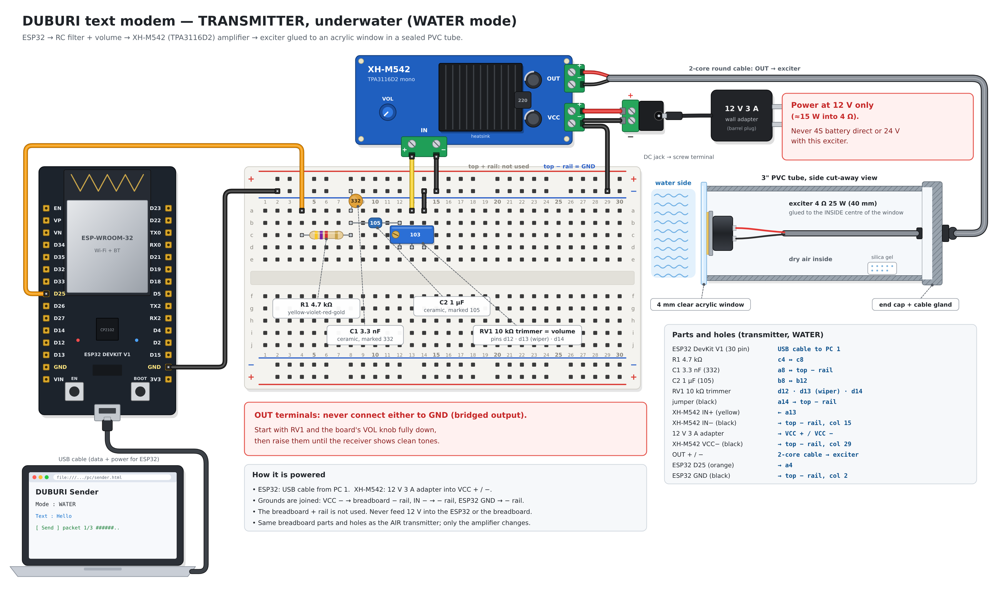
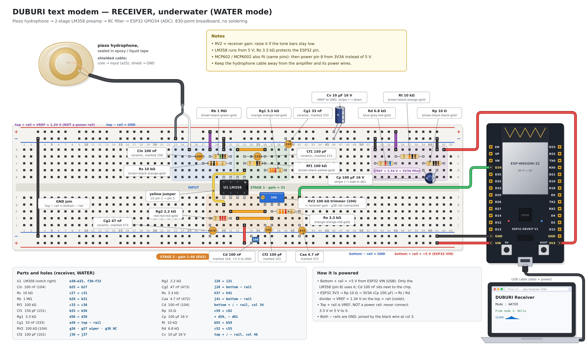
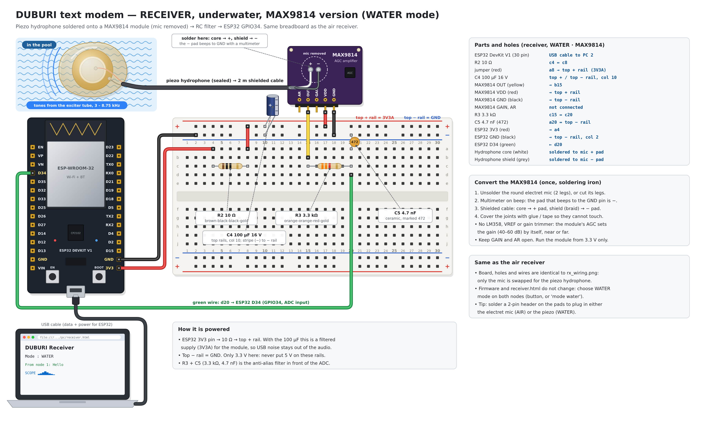

# Breadboard placement: DUBURI air-acoustic text modem

Generated by `wiring.py` (the script also checks every connection against the
circuit). Board: 400-point half breadboard. Columns 1–30 from left to right. Rows
`a`–`e` are the top half (`a` next to the top rails), `f`–`j` the bottom half. Each
column of `a`–`e` is one connected strip. Top rails: `TR1` = outer row with the red
line (+), `TR2` = inner row with the blue line (−). On these small boards the rail
has no hole at columns 1, 7, 13, 19 and 25.

ESP32 DevKit V1 (DOIT, 30 pins) and the modules sit next to the breadboard and are
joined with jumper wires (male-to-female for module pins and ESP32 pins).

## Transmitter node (PC 1)

Top + rail = 5 V from the wall adapter, top − rail = GND. The ESP32 is powered by
its USB cable; only its GND is joined to the − rail.

| Part | Value / marking | Holes |
|---|---|---|
| R1 | 4.7 kΩ (yellow-violet-red-gold) | `c4` ↔ `c8` |
| C1 | 3.3 nF ceramic, marked `332` | `a8` ↔ top − rail col 8 (`TR2-8`) |
| C2 | 1 µF ceramic, marked `105` | `b8` ↔ `b12` |
| RV1 | 10 kΩ trimmer, marked `103` | `d12` (end) · `d13` (wiper) · `d14` (end) |
| C3 | 1000 µF 16 V electrolytic | + leg top + rail col 6 (`TR1-6`), − leg (stripe) top − rail col 6 (`TR2-6`) |
| PAM8403 module | 5 V class-D amp | off the board, wired (see wires) |
| Speaker | 4 Ω, 3 W (4–8 Ω, 3–5 W OK) | PAM8403 `L+` and `L−` only |
| 5 V 2 A adapter + DC-jack-to-screw-terminal | | `+` → `TR1-30`, `−` → `TR2-30` |

### Wires

| From | To | Colour | What it is |
|---|---|---|---|
| ESP32 D25 | `a4` | orange | tone signal |
| ESP32 GND (right side, 2nd from bottom) | top − rail col 2 (`TR2-2`) | black | common ground |
| `a14` | top − rail col 14 (`TR2-14`) | black | RV1 low end to ground |
| PAM8403 L | `a13` | yellow | volume wiper to amp input |
| PAM8403 G | top − rail col 12 (`TR2-12`) | black | amp input ground |
| PAM8403 +5V | top + rail col 9 (`TR1-9`) | red | amp power +5 V |
| PAM8403 GND | top − rail col 10 (`TR2-10`) | black | amp power ground |
| DC terminal + | top + rail col 30 (`TR1-30`) | red | adapter +5 V to top + rail |
| DC terminal − | top − rail col 30 (`TR2-30`) | black | adapter ground to top − rail |
| PAM8403 L+ | speaker + | red | speaker + |
| PAM8403 L− | speaker − | black | speaker − |

Safety: the PAM8403 output is bridge-tied (BTL). Never connect `L+` or `L−` to GND
and never join two output pins. Start with RV1 turned all the way down.

## Receiver node (PC 2)

Top + rail = 3V3A: the ESP32 `3V3` pin through the 10 Ω resistor, smoothed by the
100 µF capacitor. Top − rail = GND. Only 3.3 V on this board.

| Part | Value / marking | Holes |
|---|---|---|
| R2 | 10 Ω (brown-black-black-gold) | `c4` ↔ `c8` |
| C4 | 100 µF 16 V electrolytic | + leg top + rail col 10 (`TR1-10`), − leg (stripe) top − rail col 10 (`TR2-10`) |
| MAX9814 module | mic amplifier with AGC | off the board, wired (see wires); `GAIN`, `AR` not connected |
| R3 | 3.3 kΩ (orange-orange-red-gold) | `c15` ↔ `c20` |
| C5 | 4.7 nF ceramic, marked `472` | `a20` ↔ top − rail col 20 (`TR2-20`) |

### Wires

| From | To | Colour | What it is |
|---|---|---|---|
| ESP32 3V3 | `a4` | red | 3.3 V from ESP32 |
| ESP32 GND (right side, 2nd from bottom) | top − rail col 2 (`TR2-2`) | black | common ground |
| `a8` | top + rail col 8 (`TR1-8`) | red | filtered 3.3 V (3V3A) to top + rail |
| MAX9814 OUT | `b15` | yellow | audio out |
| MAX9814 VDD | top + rail col 17 (`TR1-17`) | red | mic power 3V3A |
| MAX9814 GND | top − rail col 18 (`TR2-18`) | black | mic ground |
| `d20` | ESP32 D34 (GPIO34) | green | to ADC GPIO34 |

MAX9814 gain: `GAIN` open = 60 dB, `GAIN` to GND = 50 dB, `GAIN` to VDD = 40 dB.
Use a lower gain if the signal clips (the firmware's `stats` command shows the ADC
level). Pin order differs between MAX9814 boards: follow the printed labels.

---

# Underwater (WATER mode)

Same firmware, web pages and protocol; set both boards to `mode water`.

## Transmitter node, underwater (PC 1)

The breadboard part (RC filter + volume) is the same as the AIR transmitter, in the
same holes. The PAM8403, the 5 V adapter and the 1000 µF are not used. The amplifier
is an XH-M542 (TPA3116D2) board powered by its own 12 V 3 A adapter; only GND is
shared with the breadboard (the breadboard + rail is not used).

| Part | Value / marking | Holes |
|---|---|---|
| R1 | 4.7 kΩ (yellow-violet-red-gold) | `c4` ↔ `c8` |
| C1 | 3.3 nF ceramic, marked `332` | `a8` ↔ top − rail col 8 (`TR2-8`) |
| C2 | 1 µF ceramic, marked `105` | `b8` ↔ `b12` |
| RV1 | 10 kΩ trimmer, marked `103` | `d12` (end) · `d13` (wiper) · `d14` (end) |
| XH-M542 board | TPA3116D2 mono amplifier (blue, heatsink, VOL knob) | off the board (see wires) |
| 12 V 3 A adapter + DC-jack-to-screw-terminal |  | `+` → XH-M542 VCC +, `−` → VCC − |
| Exciter tube | 40 mm exciter 4 Ω 25 W glued inside a 4 mm acrylic window; 3" PVC tube, end cap + cable gland, silica gel | 2-core round cable from XH-M542 OUT + / − |

### Wires

| From | To | Colour | What it is |
|---|---|---|---|
| ESP32 D25 | `a4` | orange | tone signal |
| ESP32 GND (right side, 2nd from bottom) | top − rail col 2 (`TR2-2`) | black | common ground |
| `a14` | top − rail col 14 (`TR2-14`) | black | RV1 low end to ground |
| XH-M542 IN+ | `a13` | yellow | volume wiper to amp input + |
| XH-M542 IN− | top − rail col 15 (`TR2-15`) | black | amp input − to ground |
| 12 V DC terminal + | XH-M542 VCC+ | red | 12 V adapter + to amp VCC + |
| 12 V DC terminal − | XH-M542 VCC− | black | 12 V adapter − to amp VCC − |
| XH-M542 VCC− | top − rail col 29 (`TR2-29`) | black | amp ground to breadboard − rail (same screw as the adapter −) |
| XH-M542 OUT+ | exciter + | red | 2-core cable, core 1 to exciter |
| XH-M542 OUT− | exciter − | black | 2-core cable, core 2 to exciter |

Two wires go into the XH-M542 `VCC −` screw: the adapter `−` and the black wire to the
breadboard − rail.

Safety: power at 12 V only (≈15 W into 4 Ω); never a 4S battery direct or 24 V with this
exciter. The OUT terminals are a bridged output: never connect either to GND. Start
with RV1 and the board's VOL knob fully down.

## Receiver node, underwater (PC 2)

Board: 830-point breadboard (MB-102), columns 1–63. Each rail row has 50 holes in 10
groups of 5, under columns 3–7, 9–13, 15–19, …, 57–61 (no rail hole at columns 1, 2, 8,
14, 20, 26, 32, 38, 44, 50, 56, 62, 63). On some 830-point boards each rail is split in
the middle (a gap after column 31): if yours is, bridge the two halves of every rail
used here with a short jumper.

Rails: bottom + rail = +5 V from ESP32 `VIN` (LM358 only). Top + rail = VREF ≈ 1.34 V
(from 3V3A through the 10 kΩ / 6.8 kΩ divider): **not a power rail**. Both − rails are GND,
joined by a wire at column 3. ESP32 `3V3` → 10 Ω → 3V3A (100 µF) feeds only the divider.

| Part | Value / marking | Holes |
|---|---|---|
| U1 | LM358 dual op-amp, DIP-8 | pin 1 `e33` · pin 2 `e32` · pin 3 `e31` · pin 4 `e30`; pin 5 `f30` · pin 6 `f31` · pin 7 `f32` · pin 8 `f33` (notch to the right) |
| Cin | 100 nF ceramic, marked `104` | `b25` ↔ `b27` |
| Rs | 10 kΩ (brown-black-orange-gold) | `c27` ↔ `c31` |
| Rb | 1 MΩ (brown-black-green-gold) | `b31` ↔ `b28` |
| Rf1 | 100 kΩ (brown-black-yellow-gold) | `c36` ↔ `c33` |
| Cf1 | 150 pF ceramic, marked `151` | `b36` ↔ `b33` |
| Rg1 | 3.3 kΩ (orange-orange-red-gold) | `d36` ↔ `d39` |
| Cg1 | 33 nF ceramic, marked `333` | `a39` ↔ top − rail col 39 (`TR2-39`) |
| RV2 | 100 kΩ trimmer, marked `104` | `g36` (end) · `g37` (wiper) · `g38` (end, not connected) |
| Cf2 | 100 pF ceramic, marked `101` | `j36` ↔ `j37` |
| Rg2 | 2.2 kΩ (red-red-red-gold) | `i31` ↔ `i28` |
| Cg2 | 47 nF ceramic, marked `473` | `j28` ↔ bottom − rail col 28 (`BR1-28`) |
| Ro | 3.3 kΩ (orange-orange-red-gold) | `h37` ↔ `h41` |
| Caa | 4.7 nF ceramic, marked `472` | `j41` ↔ bottom − rail col 41 (`BR1-41`) |
| Cd | 100 nF ceramic, marked `104` | bottom + rail col 34 (`BR2-34`) ↔ bottom − rail col 34 (`BR1-34`) |
| Rp | 10 Ω (brown-black-black-gold) | `c62` ↔ `c59` |
| Cp | 100 µF 16 V electrolytic | + leg `d59`, − leg (stripe) `d61` |
| Rt | 10 kΩ (brown-black-orange-gold) | `b59` ↔ `b55` |
| Rd | 6.8 kΩ (blue-grey-red-gold) | `c55` ↔ `c52` |
| Cv | 10 µF 16 V electrolytic | + leg top + rail col 46 (`TR1-46`), − leg (stripe) top − rail col 46 (`TR2-46`) |
| Piezo hydrophone | brass piezo disc sealed in epoxy / liquid tape, shielded cable | core → `a25`, shield → top − rail col 23 (`TR2-23`) |

### Wires

| From | To | Colour | What it is |
|---|---|---|---|
| ESP32 VIN | bottom + rail col 61 (`BR2-61`) | red | +5 V (VIN) to bottom + rail |
| ESP32 GND (left side, 2nd from bottom) | bottom − rail col 61 (`BR1-61`) | black | ground to bottom − rail |
| ESP32 3V3 | `a62` | red | 3.3 V from the ESP32 into the 10 Ω filter |
| `f41` | ESP32 D34 (GPIO34) | green | ADC node to GPIO34 |
| hydrophone cable core | `a25` | white | hydrophone cable core (signal) |
| hydrophone cable shield | top − rail col 23 (`TR2-23`) | grey | hydrophone cable shield to ground |
| top − rail col 3 (`TR2-3`) | bottom − rail col 3 (`BR1-3`) | black | joins top and bottom − rails |
| `a30` | top − rail col 30 (`TR2-30`) | black | U1 pin 4 to ground |
| `a28` | top + rail col 28 (`TR1-28`) | violet | VREF from the top + rail to Rb |
| `a32` | `a36` | orange | U1 pin 2 (INA−) to Rf1 / Cf1 / Rg1 |
| `d33` | `g30` | yellow | U1 pin 1 (OUTA) to pin 5 (INB+), around the chip |
| `j33` | bottom + rail col 33 (`BR2-33`) | red | U1 pin 8 to +5 V |
| `h31` | `h36` | orange | U1 pin 6 (INB−) to RV2 / Cf2 |
| `i32` | `i37` | orange | U1 pin 7 (OUTB) to RV2 wiper / Cf2 / Ro |
| `a55` | top + rail col 55 (`TR1-55`) | violet | VREF onto the top + rail |
| `a52` | top − rail col 52 (`TR2-52`) | black | Rd to ground |
| `a61` | top − rail col 61 (`TR2-61`) | black | Cp − to ground |

Gain: stage 1 = 1 + 100 k / 3.3 k ≈ 31. Stage 2 = 1 + RV2 / 2.2 k, from 1 to ≈ 46 (RV2 is the
receiver gain: raise it if the tone bars stay low). Ro 3.3 kΩ protects the ESP32 pin.
MCP602 / MCP6002 also fit (same pins): then power pin 8 from 3V3A instead of 5 V. Keep
the hydrophone cable away from the amplifier and its power wires.

## Receiver node, underwater, MAX9814 version (PC 2) — fewer parts

Instead of the LM358 preamp: the air receiver's board and MAX9814 module, with the
module's built-in electret mic removed and the piezo hydrophone soldered to its two
pads. No op-amp, VREF or gain trimmer: the module's AGC sets the gain (40–60 dB).
Breadboard holes and jumper wires are exactly those of the air receiver above.

Convert the module once: unsolder (or cut) the round electret mic; with a multimeter on
beep, the pad that beeps to the `GND` pin is the − pad; solder the shielded cable's core
to the + pad and its shield to the − pad; insulate the joints. Keep `GAIN` and `AR` open
and power the module from 3.3 V only.

| Part | Value / marking | Holes |
|---|---|---|
| R2 | 10 Ω (brown-black-black-gold) | `c4` ↔ `c8` |
| C4 | 100 µF 16 V electrolytic | + leg top + rail col 10 (`TR1-10`), − leg (stripe) top − rail col 10 (`TR2-10`) |
| R3 | 3.3 kΩ (orange-orange-red-gold) | `c15` ↔ `c20` |
| C5 | 4.7 nF ceramic, marked `472` | `a20` ↔ top − rail col 20 (`TR2-20`) |
| MAX9814 module (mic removed) | AGC amplifier, 40–60 dB | off the board, wired as in the air receiver; `GAIN`, `AR` not connected |
| Piezo hydrophone | brass piezo disc sealed in epoxy / liquid tape, shielded cable | core soldered to the mic + pad, shield to the mic − pad |

### Wires

| From | To | Colour | What it is |
|---|---|---|---|
| ESP32 3V3 | `a4` | red | 3.3 V from ESP32 |
| ESP32 GND (right side, 2nd from bottom) | top − rail col 2 (`TR2-2`) | black | common ground |
| `a8` | top + rail col 8 (`TR1-8`) | red | filtered 3.3 V (3V3A) to top + rail |
| MAX9814 OUT | `b15` | yellow | audio out |
| MAX9814 VDD | top + rail col 17 (`TR1-17`) | red | mic power 3V3A |
| MAX9814 GND | top − rail col 18 (`TR2-18`) | black | mic ground |
| `d20` | ESP32 D34 (GPIO34) | green | to ADC GPIO34 |
| hydrophone cable core | MAX9814 mic + pad (soldered) | white | cable core soldered to the mic + pad |
| hydrophone cable shield | MAX9814 mic − pad (GND, soldered) | grey | cable shield soldered to the mic − pad (GND) |

Firmware and web pages are unchanged; set both nodes to `mode water`.
